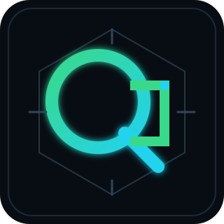

<!--
  OQ DEVELOPER — PROFILE README
  Identity: Eng. Osama Ali
  GitHub login retained from the supplied source file: engosamaali7
-->

  

  

  
  
  
  

---

## 01 / ABOUT ME

I'm **Eng. Osama Ali**, the developer behind **OQ Developer** — an identity built around thoughtful software development, security-minded engineering, and continuous learning.

I'm an **Information Technology student from Yemen**, interested in building secure, scalable applications and contributing to the open-source community. My learning interests include cybersecurity, ethical hacking, AI, and cloud technologies.

> **Build with intent. Engineer with security in mind. Keep learning.**

  

## 02 / TECHNICAL EXPERTISE

**OQ focus domains:** Software Engineering · Web Development · Mobile App Development · Artificial Intelligence · Cybersecurity · Open Source · Automation · Developer Tools.

These are the brand's focus and growth domains, not a claim of equal proficiency in every area.

| Focus | Direction |
|---|---|
| **Software Development** | Building secure and scalable applications |
| **Cybersecurity** | Ethical hacking and penetration-testing learning path |
| **Artificial Intelligence** | Exploring AI-driven threat detection |
| **Cloud Technologies** | Learning cloud platforms and cloud security |
| **Open Source** | Interested in contributing to developer tools and community projects |

## 03 / TECHNOLOGY STACK

The technologies below are carried over from the supplied profile README. They are presented as a technology inventory, **not as proficiency rankings**.

### Programming Languages
      

### Frameworks & Libraries
      

### Databases
    

### Tools & Platforms
         

### IDEs & Editors
    

### Operating Systems
   

## 04 / FEATURED PROJECTS

The following repositories were named in the original profile file. The supplied file did not include verified project descriptions, technology mappings, screenshots, or repository metadata, so the cards intentionally avoid inventing those details.

<table>
  <tr>
    <td width="50%" valign="top">
      <strong>01 · Secure API Gateway</strong> 
      Repository listed in the source profile.  
      <a href="https://github.com/engosamaali7/secure-api-gateway">OPEN REPOSITORY ↗</a>
    </td>
    <td width="50%" valign="top">
      <strong>02 · Cyber Threat Hunter</strong> 
      Repository listed in the source profile.  
      <a href="https://github.com/engosamaali7/cyber-threat-hunter">OPEN REPOSITORY ↗</a>
    </td>
  </tr>
  <tr>
    <td width="50%" valign="top">
      <strong>03 · Laravel AI-Driven Firewall</strong> 
      Repository listed in the source profile.  
      <a href="https://github.com/engosamaali7/laravel-ai-driven-firewall">OPEN REPOSITORY ↗</a>
    </td>
    <td width="50%" valign="top">
      <strong>04 · Dotfiles</strong> 
      Repository listed in the source profile.  
      <a href="https://github.com/engosamaali7/dotfiles">OPEN REPOSITORY ↗</a>
    </td>
  </tr>
</table>

## 05 / GITHUB STATISTICS

These cards request live public GitHub data. Their values are generated by the external services and are not hard-coded in this README.

  

  
  

  

## 06 / CONTRIBUTION ACTIVITY

  

### Contribution Snake

The snake animation is generated by the included GitHub Actions workflow and published to the `output` branch.

  <picture>
    <source media="(prefers-color-scheme: dark)" srcset="https://raw.githubusercontent.com/engosamaali7/engosamaali7/output/github-snake-dark.svg" />
    <source media="(prefers-color-scheme: light)" srcset="https://raw.githubusercontent.com/engosamaali7/engosamaali7/output/github-snake.svg" />
    
  </picture>

## 07 / DEVELOPMENT PHILOSOPHY

> **Good software is more than working code.**
>
> It should be secure by design, understandable to the next developer, maintainable over time, and useful to the people who depend on it.

- **Security is a design requirement**, not a final checklist.
- **Clarity beats unnecessary complexity.**
- **Continuous learning** keeps engineering relevant.
- **Open source** makes knowledge and improvement shareable.

## 08 / CURRENT FOCUS

- Advanced penetration testing and ethical hacking.
- Cloud security and infrastructure fundamentals.
- AI-driven threat detection.
- Reading and applying ideas from *Clean Code* and *The Web Application Hacker's Handbook*.
- Working toward the OSCP and AWS security certification goals listed in the original profile.

## 09 / CONNECT WITH ME

  <a href="https://github.com/engosamaali7">GitHub</a>
  &nbsp;·&nbsp;
  <a href="https://linkedin.com/in/engosamaali7">LinkedIn</a>
  &nbsp;·&nbsp;
  <a href="https://twitter.com/engosamaali7">X / Twitter</a>
  &nbsp;·&nbsp;
  <a href="https://t.me/engosamaali7">Telegram</a>
  &nbsp;·&nbsp;
  <a href="mailto:engosamaali7@proton.me">Email</a>

  Yemen · Arabic (Native) · English (Fluent)

---

  <strong>OQ DEVELOPER</strong> 
  DESIGN THE FUTURE. BUILD THE NEXT GENERATION.

