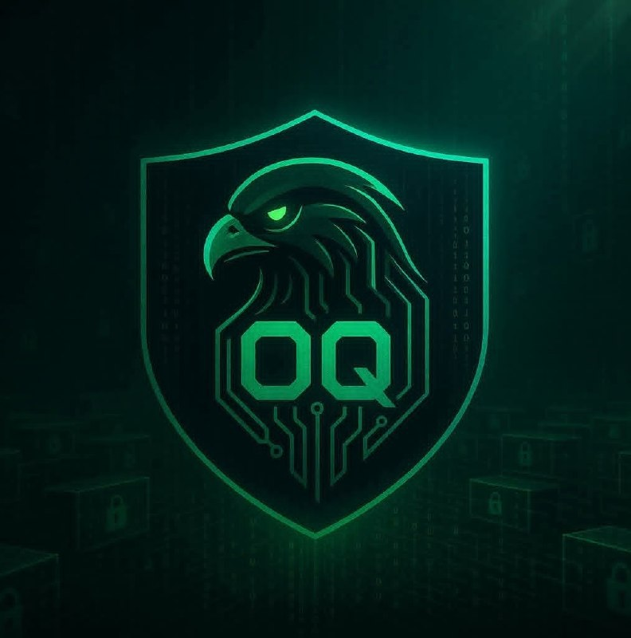

<!--
  OQ DEVELOPER — NEXT GENERATION README
  Owner: Eng. Osama Ali
  Brand: OQ Developer
-->

  

  

<h1 align="center">OQ Developer</h1>
<h3 align="center">Eng. Osama Ali</h3>

  

  
  
  
  
  
  

  
  

---

# 01 / ABOUT ME

I’m **Eng. Osama Ali**, the mind behind **OQ Developer** — a personal brand focused on **future-ready software development**, **cybersecurity awareness**, and **continuous technical growth**.

I’m an **Information Technology student from Yemen**, passionate about building secure, scalable, and impactful digital solutions. My interests span across **Software Engineering**, **Web Development**, **Artificial Intelligence**, **Cybersecurity**, **Open Source**, and **Developer Tools**.

> **Design the future. Build with purpose. Secure with intelligence.**

---

# 02 / CORE DOMAINS

- **Software Engineering**
- **Web Development**
- **Mobile App Development**
- **Artificial Intelligence**
- **Cybersecurity**
- **Open Source**
- **Automation**
- **Developer Tools**

---

# 03 / TECHNOLOGY STACK

## Programming Languages

  
  
  
  
  
  
  

## Frameworks & Libraries

  
  
  
  
  
  
  

## Databases

  
  
  
  
  

## Tools & Platforms

  
  
  
  
  
  
  
  
  
  

## IDEs & Editors

  
  
  
  
  

## Operating Systems

  
  
  
  

---

# 04 / GITHUB ANALYTICS

  

  
  

  

---

# 05 / CONTRIBUTION ACTIVITY

  

## Contribution Snake

  <picture>
    <source media="(prefers-color-scheme: dark)" srcset="https://raw.githubusercontent.com/Eng-Osama-Ali-Al-qudsi/OQ-Developer/output/github-snake-dark.svg" />
    <source media="(prefers-color-scheme: light)" srcset="https://raw.githubusercontent.com/Eng-Osama-Ali-Al-qudsi/OQ-Developer/output/github-snake.svg" />
    
  </picture>

---

# 06 / DEVELOPMENT PHILOSOPHY

> **Good software is more than working code.**  
> It should be secure by design, understandable to the next developer, maintainable over time, and useful to the people who depend on it.

- **Security is a design requirement**, not a final checklist.
- **Clarity beats unnecessary complexity.**
- **Continuous learning keeps engineering relevant.**
- **Open source makes knowledge and improvement shareable.**

---

# 07 / CURRENT FOCUS

- Advanced penetration testing and ethical hacking.
- Cloud security and infrastructure fundamentals.
- AI-driven threat detection.
- Software development with security-first thinking.
- Continuous learning and open-source growth.

---

# 08 / CONNECT WITH ME

  
  
  
  
  
  

  <strong>Location:</strong> Yemen &nbsp;•&nbsp;
  <strong>Languages:</strong> Arabic, English

---

  <b>OQ Developer</b> 
  Design the Future. Build the Next Generation.

  

