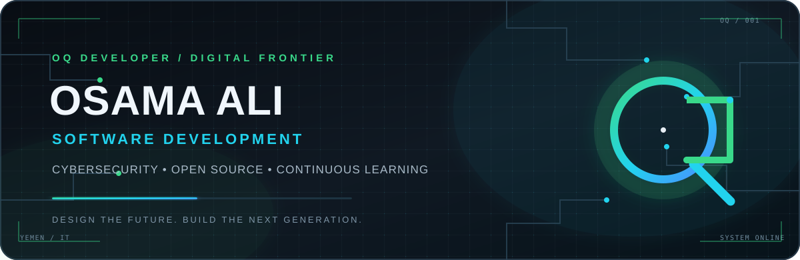
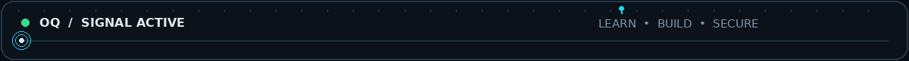

<!--
  OQ DEVELOPER — PROFILE README
  Identity: Eng. Osama Ali
  GitHub login: Eng-Osama-Ali-Al-qudsi
-->

  

  

  
  
  
  
  
  

---

## 01 / ABOUT ME

I'm **Eng. Osama Ali**, the developer behind **OQ Developer** — an identity built around thoughtful software development, security-minded engineering, and continuous learning.

I'm an **Information Technology student from Yemen**, interested in building secure, scalable applications and contributing to the open-source community. My learning interests include cybersecurity, ethical hacking, AI, and cloud technologies.

> **Build with intent. Engineer with security in mind. Keep learning.**

  

## 02 / TECHNICAL EXPERTISE

**OQ focus domains:** Software Engineering · Web Development · Mobile App Development · Artificial Intelligence · Cybersecurity · Open Source · Automation · Developer Tools.

These are the brand's focus and growth domains, not a claim of equal proficiency in every area. Select a card to explore a relevant learning resource.

<table>
  <tr>
    <td width="50%" valign="top">
      
       
      <strong>Engineering & Building</strong> 
      Building secure and scalable applications. 
      <a href="https://skills.github.com/">Explore learning resources ↗</a>
    </td>
    <td width="50%" valign="top">
      
       
      <strong>Security Mindset</strong> 
      Ethical hacking and penetration-testing learning path. 
      <a href="https://owasp.org/www-project-top-ten/">Explore OWASP ↗</a>
    </td>
  </tr>
  <tr>
    <td width="50%" valign="top">
      
       
      <strong>Intelligent Systems</strong> 
      Exploring AI-driven threat detection. 
      <a href="https://ai.google.dev/">Explore AI resources ↗</a>
    </td>
    <td width="50%" valign="top">
      
       
      <strong>Cloud Foundations</strong> 
      Learning cloud platforms and cloud security. 
      <a href="https://aws.amazon.com/what-is-cloud-computing/">Explore cloud concepts ↗</a>
    </td>
  </tr>
  <tr>
    <td width="50%" valign="top">
      
       
      <strong>Community & Collaboration</strong> 
      Interested in contributing to developer tools and community projects. 
      <a href="https://opensource.guide/">Explore open-source guide ↗</a>
    </td>
    <td width="50%" valign="top">
      
       
      <strong>Automation & Developer Tools</strong> 
      Exploring workflows and tools that improve development processes. 
      <a href="https://docs.github.com/en/actions">Explore GitHub Actions ↗</a>
    </td>
  </tr>
</table>

## 03 / TECHNOLOGY STACK

The technologies below are carried over from the supplied profile README. They are presented as a technology inventory, **not as proficiency rankings**.

### Programming Languages

SELECT A LANGUAGE · EACH BADGE OPENS ITS DOCUMENTATION

  
  
  
  
  
  
  
  

### Frameworks, Libraries & Runtime

FRAMEWORKS AND RUNTIMES · SELECT A BADGE TO OPEN ITS DOCUMENTATION

  
  
  
  
  
  
  
  

Dart is listed as a programming language; Flutter and Django are listed with frameworks.

### Databases

    

### Tools & Platforms

         

### IDEs & Editors

    

### Operating Systems

   

## 04 / FEATURED PROJECTS

OQ PROJECT INDEX · SELECT A PROJECT CARD TO OPEN ITS GITHUB REPOSITORY

<table>
  <tr>
    <td width="50%" valign="top">
      
        
      <strong>Secure API Gateway</strong> 
      Repository referenced in the supplied profile.  
      <a href="https://github.com/Eng-Osama-Ali-Al-qudsi/secure-api-gateway">OPEN REPOSITORY ↗</a>
    </td>
    <td width="50%" valign="top">
      
        
      <strong>Cyber Threat Hunter</strong> 
      Repository referenced in the supplied profile.  
      <a href="https://github.com/Eng-Osama-Ali-Al-qudsi/cyber-threat-hunter">OPEN REPOSITORY ↗</a>
    </td>
  </tr>
  <tr>
    <td width="50%" valign="top">
      
        
      <strong>Laravel AI-Driven Firewall</strong> 
      Repository referenced in the supplied profile.  
      <a href="https://github.com/Eng-Osama-Ali-Al-qudsi/laravel-ai-driven-firewall">OPEN REPOSITORY ↗</a>
    </td>
    <td width="50%" valign="top">
      
        
      <strong>Dotfiles</strong> 
      Repository referenced in the supplied profile.  
      <a href="https://github.com/Eng-Osama-Ali-Al-qudsi/dotfiles">OPEN REPOSITORY ↗</a>
    </td>
  </tr>
</table>

Project descriptions and technology mappings were not included in the supplied source, so no unsupported details or stack labels have been added.

## 05 / GITHUB STATISTICS

These cards request live public GitHub data. Their values are generated by the external services and are not hard-coded in this README.

  

  
  

  

## 06 / CONTRIBUTION ACTIVITY

  

### Contribution Snake

The snake animation is generated by the included GitHub Actions workflow and published to the `output` branch.

  <picture>
    <source media="(prefers-color-scheme: dark)" srcset="https://raw.githubusercontent.com/Eng-Osama-Ali-Al-qudsi/OQ-Developer/output/github-snake-dark.svg" />
    <source media="(prefers-color-scheme: light)" srcset="https://raw.githubusercontent.com/Eng-Osama-Ali-Al-qudsi/OQ-Developer/output/github-snake.svg" />
    
  </picture>

## 07 / DEVELOPMENT PHILOSOPHY

  

> **Good software is more than working code.**
>
> It should be secure by design, understandable to the next developer, maintainable over time, and useful to the people who depend on it.

<table>
  <tr>
    <td width="50%" valign="top">
      <strong>01 / SECURITY BY DESIGN</strong> 
      Security is a design requirement, not a final checklist.
    </td>
    <td width="50%" valign="top">
      <strong>02 / ENGINEERING CLARITY</strong> 
      Clarity beats unnecessary complexity.
    </td>
  </tr>
  <tr>
    <td width="50%" valign="top">
      <strong>03 / CONTINUOUS LEARNING</strong> 
      Continuous learning keeps engineering relevant.
    </td>
    <td width="50%" valign="top">
      <strong>04 / OPEN COLLABORATION</strong> 
      Open source makes knowledge and improvement shareable.
    </td>
  </tr>
</table>

## 08 / CURRENT FOCUS

ACTIVE LEARNING & DEVELOPMENT TRACKS · AREAS OF FOCUS, NOT CLAIMS OF CERTIFICATION

<table>
  <tr>
    <td width="12%" align="center"><strong>01</strong></td>
    <td valign="top">
      <strong>Cybersecurity Practice</strong> 
      Advanced penetration testing and ethical hacking.
    </td>
    <td width="22%" align="center">
      
    </td>
  </tr>
  <tr>
    <td align="center"><strong>02</strong></td>
    <td valign="top">
      <strong>Cloud & Infrastructure</strong> 
      Cloud security and infrastructure fundamentals.
    </td>
    <td align="center">
      
    </td>
  </tr>
  <tr>
    <td align="center"><strong>03</strong></td>
    <td valign="top">
      <strong>AI & Threat Detection</strong> 
      AI-driven threat detection.
    </td>
    <td align="center">
      
    </td>
  </tr>
  <tr>
    <td align="center"><strong>04</strong></td>
    <td valign="top">
      <strong>Technical Reading</strong> 
      Reading and applying ideas from <em>Clean Code</em> and <em>The Web Application Hacker's Handbook</em>.
    </td>
    <td align="center">
      
    </td>
  </tr>
  <tr>
    <td align="center"><strong>05</strong></td>
    <td valign="top">
      <strong>Certification Roadmap</strong> 
      Working toward the OSCP and AWS security certification goals listed in the original profile.
    </td>
    <td align="center">
      
    </td>
  </tr>
</table>

## 09 / CONNECT WITH ME

  <strong>LET'S BUILD SOMETHING MEANINGFUL.</strong> 
  Choose your preferred channel — each card opens the correct contact destination.

<table>
  <tr>
    <td width="50%" align="center" valign="middle">
       
      <strong>+967 780 155 801</strong>
    </td>
    <td width="50%" align="center" valign="middle">
       
      <strong>engosamaali7@gmail.com</strong>
    </td>
  </tr>
  <tr>
    <td width="50%" align="center" valign="middle">
       
      <strong>@OSAMAHWHW</strong>
    </td>
    <td width="50%" align="center" valign="middle">
       
      <strong>OQ Developer on Facebook</strong>
    </td>
  </tr>
  <tr>
    <td width="50%" align="center" valign="middle">
       
      <strong>Eng-Osama-Ali-Al-qudsi</strong>
    </td>
    <td width="50%" align="center" valign="middle">
       
      <strong>Eng. Osama Ali</strong>
    </td>
  </tr>
</table>

  Based in Yemen · Connect, collaborate, and build.

  <strong>OQ DEVELOPER</strong> 
  DESIGN THE FUTURE. BUILD THE NEXT GENERATION.

